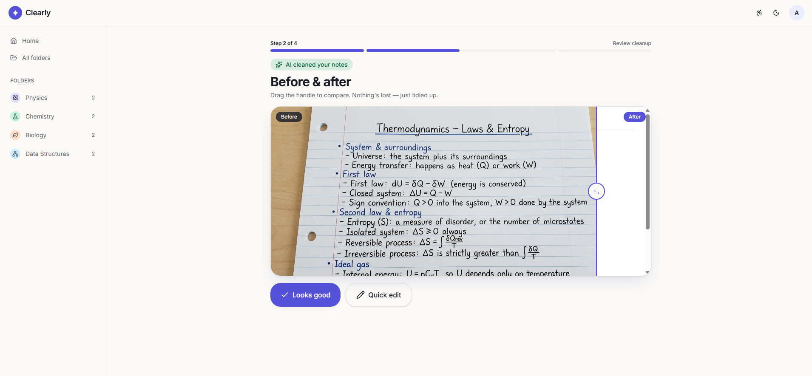
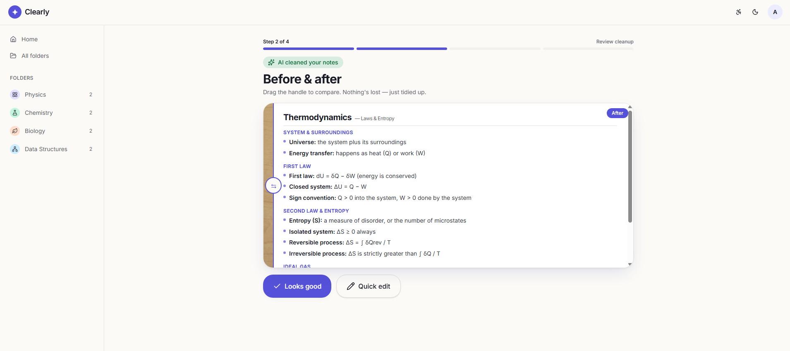
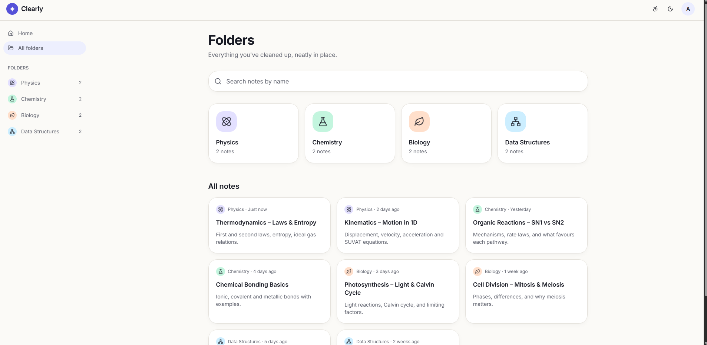
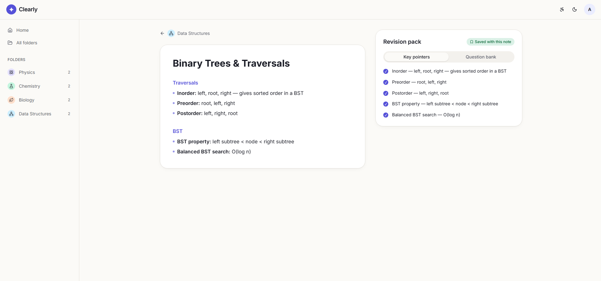
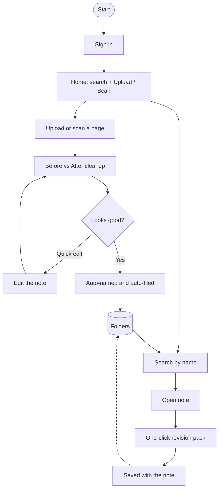

# Clearly

**From messy notes to exam-ready in one tap.**

Snap your handwritten lecture notes. Clearly cleans them up, names and files them automatically, and builds key pointers and a quiz for revision.

**Live demo:** https://clearly-notes.deployxa.online

Built for the HyperBloom October: UI/UX & Web Design Hackathon.

| Before (messy handwritten page) | After (clean, organized note) |
|---|---|
|  |  |

| Folders and search | Revision pack |
|---|---|
|  |  |

## Problem

Students take messy handwritten notes, then lose hours organizing them and turning them into revision material. Existing apps are heavy workspaces, hide key features behind paywalls, or leave the organizing to the student.

## User journey



1. **Sign in** with Google or email.
2. **Home:** search bar, **Upload photo/PDF** and **Scan with camera**, recent notes and folders.
3. **Cleanup:** drag a slider to compare the original page with the cleaned notes. Confirm with **Looks good** or fix anything with **Quick edit**.
4. **Auto-filed:** the note is named and placed in a folder automatically, with one-tap rename or change folder.
5. **Search:** find notes by name, with highlighted matches.
6. **Revision pack:** one click gives key pointers and a 10-question bank with tap-to-reveal answers, saved with the note.

## Design and accessibility

- **Fewest steps:** naming and filing are automatic, so the student only confirms.
- **Trust in AI:** the before/after view and Quick edit let students check and correct the result.
- **Accessibility panel:** dyslexia-friendly font, high contrast, three text sizes, reduced motion, plus light and dark mode. Choices are saved on the device.
- **Calm, minimal UI** with clear progress steps.

## Student insights

Based on feedback and discussions from online student communities (Reddit, Discord) regarding current note-taking apps (Notion, GoodNotes, Obsidian), three major friction points emerged:

- **The "Digital Conversion" Tax:** Students prefer handwriting notes during intense lectures for retention, but hate the manual grind of typing them up later. Apps that don't do instant, clean extraction are abandoned quickly.
- **Organization Fatigue:** Heavily customizable apps (like Notion or Obsidian) cause friction. Students admit they get overwhelmed building folder structures and tagging everything, often leaving their uploads in a messy, unsearchable "Inbox" pile.
- **The Active Recall Gap:** Reviewing passive notes isn't enough for exam prep, but manually creating flashcards or quizzes takes hours. Students explicitly asked for a tool that bridges the gap between *storing text* and *testing knowledge* without extra effort.


## Prototype status

A frontend prototype of the experience. Notes, folders and question banks use **mock data**, and the AI cleanup is **simulated** (an uploaded photo shows as Before, a prepared clean note shows as After). No backend or real login yet.

**Next:** real handwriting recognition and cleanup, saved accounts, and Google Drive integration.

## Tech and deployment

TanStack Start, React, TypeScript, Tailwind CSS, shadcn/ui. Built with AI assistance (Lovable and Antigravity). Deployed on **Deployxa** (free tier) from this repo using the included `Dockerfile`.

## Run locally

```
git clone <this-repository-url>
cd <repository-name>
npm install
npm run dev
```

Built by Ashutosh.